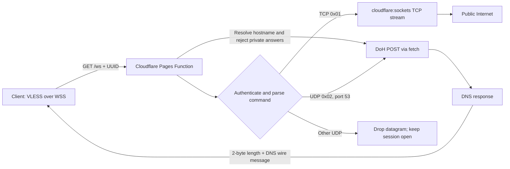

# VPN V2 architecture

Status: accepted by the user. The deployment target is Cloudflare Pages. This
choice constrains the product to an application-level TCP proxy; it cannot
provide a general-purpose IP VPN.

## Decision summary

VPN V2 is an independent Pages project with a Pages Function at `/ws`, a
minimal static page, and a secret `ACCESS_UUID`. The function authenticates
VLESS over WebSocket, streams VLESS TCP through `cloudflare:sockets`, resolves
hostnames through DoH before direct socket use, and forwards VLESS UDP requests
to port 53 through DoH. Other UDP destinations are dropped without ending the
WebSocket session.

This is the most complete data plane that fits a Pages-only requirement. It is
not a full-device tunnel: arbitrary UDP, ICMP, and other layer-3 traffic are not
available through the Pages runtime API.

## Packet flow

The client opens a TLS WebSocket to Pages. The Function validates the UUID
before opening an outbound connection. TCP hostnames are resolved through
Cloudflare DoH; direct sockets use only public A/AAAA answers. TCP bytes are
streamed in both directions with bounded buffering, backpressure, and
half-close handling. DNS datagrams use the VLESS two-byte big-endian length
prefix; the raw DNS wire query is POSTed to Cloudflare's documented DoH endpoint
and the wire response is returned in the same framing. An explicit
`OUTBOUND_PROXY_IP` may configure trusted HTTP CONNECT egress; no public relay is
selected by default.

## Cloudflare-only feasibility

Cloudflare documents outbound sockets through `cloudflare:sockets` as TCP. Its
protocol matrix lists outbound HTTP(S) and TCP sockets, but no general outbound
UDP socket interface. The conclusion that raw UDP VPN transport is unavailable
on Pages is an inference from those documented interfaces. DoH can carry DNS,
but it does not carry arbitrary UDP applications. [TCP sockets](https://developers.cloudflare.com/workers/runtime-apis/tcp-sockets/),
[supported protocols](https://developers.cloudflare.com/workers/reference/protocols/),
[DNS wireformat](https://developers.cloudflare.com/1.1.1.1/encryption/dns-over-https/make-api-requests/dns-wireformat/).

Other material limits:

- Outbound TCP sockets to Cloudflare IP ranges are blocked. A Pages-only
  deployment therefore cannot guarantee access to sites whose destination
  resolves into those ranges. A trusted external egress proxy can route around
  that limitation, but it is a separate service and makes the design hybrid.
- Workers limits include 128 MB memory and six simultaneous connections in the
  initial connection/response-header phase. This design opens one TCP socket
  per VLESS TCP session and uses DoH `fetch` for DNS. [Workers limits](https://developers.cloudflare.com/workers/platform/limits/)
  document the current connection and memory limits.
- Cloudflare can terminate open WebSockets when it deploys runtime updates.
  Clients should reconnect and retry interrupted requests. [WebSockets](https://developers.cloudflare.com/network/websockets/)
  describes these disconnects.
- Pages Functions invocations count against Workers quotas. Static assets can
  remain on Pages, but they do not improve tunnel data-plane capabilities.

See [Workers limits](https://developers.cloudflare.com/workers/platform/limits/),
[Pages limits](https://developers.cloudflare.com/pages/platform/limits/), and
[WebSockets](https://developers.cloudflare.com/network/websockets/).

## Alternatives evaluated

| Architecture | Strengths | Limitations | Fit |
| --- | --- | --- | --- |
| Cloudflare Pages only | No server to maintain; globally reachable HTTPS/WebSocket ingress; direct TCP stream API | No raw UDP; Cloudflare IP ranges blocked for outbound sockets; runtime updates can interrupt sessions | Fits the stated hosting constraint only if TCP proxy semantics are accepted |
| VPS with WireGuard and Xray | Native layer-3 WireGuard carries TCP and UDP; Xray VLESS/TLS can provide a TCP fallback; direct egress avoids the Pages TCP restriction | Requires VPS operations, updates, firewall and monitoring | Best fit for a full VPN, but conflicts with Pages-only hosting |
| Pages ingress plus VPS egress | Can keep the Pages WebSocket endpoint and route blocked destinations through a controlled egress host | Adds a network hop and a second failure domain; still cannot carry arbitrary UDP at Pages ingress; no longer Pages-only | Viable only if controlled egress is allowed as a separate component |

WireGuard sends packets over UDP and supports optional persistent keepalive for
NAT mappings. Xray documents VLESS with TLS/REALITY transports. These provide
the VPS alternative if full IP networking becomes the deciding requirement.
[WireGuard protocol](https://www.wireguard.com/protocol/),
[WireGuard quick start](https://www.wireguard.com/quickstart/),
[Xray VLESS](https://xtls.github.io/en/config/inbounds/vless.html),
[Xray transports](https://xtls.github.io/en/config/transport.html).

## V1 findings and isolation

V1 is `Foort123/edge-tcp-gateway`, Cloudflare Pages project `edge-tcp-gateway`.
It remains untouched in this phase. The current V1 source supports VLESS TCP and
DNS-over-HTTPS for VLESS UDP port 53. Its Pages production configuration exposes
`ACCESS_UUID` but no `OUTBOUND_PROXY_IP`. The last deployment visible through
the Cloudflare API is from 2026-10-24, and a previous deployment attempt was
rejected with a project-blocked error. V2 must use its own repository, project,
UUID, settings, and secrets.

The separate V2 repository already exists at `Foort123/edge-gateway-v2`; its
starting main commit was `89251ed` (`Add raw ProxyIP SNI fallback`). That version
supported TCP only and defaulted to public ProxyIP endpoints. The new
implementation removes the implicit relay, adds DNS-over-HTTPS and explicit
HTTP CONNECT support, and records the gateway as an application proxy rather
than a full IP VPN.

## Security and reliability requirements for implementation

- Store `ACCESS_UUID` only as a Pages secret; do not include production values
  in source, sample files, logs, or benchmark output.
- Reject malformed VLESS headers and unsupported commands; bound the header,
  DoH response, and queued WebSocket data.
- Keep direct TCP destinations restricted to public addresses and reject
  private, loopback, link-local, and reserved ranges after resolution where
  resolution can be checked safely.
- Require explicit configuration for any egress relay. Do not silently change
  the user's egress through a third-party public relay.
- Stream in both directions, respect backpressure, support TCP half-close, and
  close both sides on terminal errors.
- Expose only `/ws` for upgrades and serve static assets on ordinary requests.
- Document that DNS is DoH and that non-DNS UDP is unsupported.

## Verification status

The Node unit suite covers VLESS parsing and authentication, DNS framing and
validation, direct TCP and explicit CONNECT selection, session handling,
half-close, and Pages request routing. Those tests use fakes; they do not prove
Cloudflare runtime compatibility or live connectivity. Performance and
real-client end-to-end results remain untested until a deployment is available.
See [TESTING.md](TESTING.md) and [BENCHMARKS.md](BENCHMARKS.md).

## Accepted scope

The user accepted the Pages-only scope: VLESS TCP plus DNS-over-HTTPS, with no
guarantee for arbitrary UDP/ICMP or some Cloudflare-hosted destinations. V2 is
being implemented and tested against that scope.
