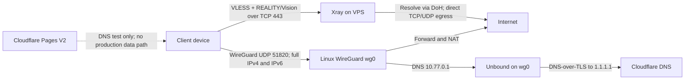

# VPN V2 architecture

Status: VPS-first implementation is in progress. The installed Pages version is
an independent DNS/tunnel prototype, not a working web-browsing VPN. The actual
WireGuard and Xray data plane has not been deployed because no VPS endpoint was
provided.

## Decision

Use a dedicated Ubuntu Server 24.04 amd64 VPS as the data plane:

- WireGuard on UDP for the fast, full-device IP tunnel. It carries IPv4 and
  IPv6, including TCP, UDP, DNS, and ICMP, subject to the VPS's egress and the
  client's network allowing UDP.
- Xray VLESS + REALITY + Vision on TCP as a fallback when UDP is blocked or
  unstable. It uses the VLESS UUID for authentication and Xray's DoH resolver
  for server-side DNS. Hiddify can import the generated VLESS profile.
- The existing V2 Pages project remains separate as a landing page and DNS
  test. It is not in the main packet path.

WireGuard keeps the common path direct and avoids an extra Cloudflare hop.
Xray provides a TCP transport fallback. REALITY is used instead of ordinary
VLESS/TLS because it is supported by current Xray and Hiddify clients and is
designed to match a TLS target's handshake. A target hostname must be selected
for the chosen VPS provider; it must be reachable and preferably in the same
ASN. Xray forwards unauthenticated REALITY handshakes to that target, so a
poorly chosen target can turn the VPS into an unintended forwarder. This is a
security requirement, not a cosmetic setting. [Xray REALITY](https://xtls.github.io/en/config/transports/reality.html)

The server setup pins official Xray-core 26.10.31 and verifies the Linux
amd64 archive SHA-256 before installation. This release is the current GitHub
Latest as of 2026-11-08 and contains an upstream security update that disables
MPTCP by default. [Xray release](https://github.com/XTLS/Xray-core/releases/tag/v26.10.31)

## Packet flow

### WireGuard path

The client routes 0.0.0.0/0 and ::/0 through wg0. The VPS forwards
traffic and applies IPv4 and IPv6 masquerading. The generated client profile
uses 10.77.0.1 and fd42:77::1 as DNS resolvers. Unbound listens only on
those tunnel addresses and forwards queries over DNS-over-TLS to Cloudflare.
If the VPS has no public IPv6 egress, IPv6 packets remain inside the tunnel and
fail closed; IPv6-only destinations will not work until the VPS has IPv6.

WireGuard's tunnel uses UDP and its client profile enables a 25-second
persistent keepalive for NAT mappings. The client network can still block or
rate-limit UDP. [WireGuard quick start](https://www.wireguard.com/quickstart/)

### Xray fallback path

The client opens a TCP connection to the VPS endpoint and Xray's configured
port, default 443. The Xray inbound validates the VLESS UUID, REALITY
server-name, public key, and short ID. Xray Vision carries the TCP stream and
Xray's freedom outbound connects directly to the destination. The Xray built-in
resolver uses https+local://1.1.1.1/dns-query; reserved and private IP ranges
are blocked in routing after hostname resolution. [VLESS](https://xtls.github.io/en/config/inbounds/vless.html),
[Xray transport configuration](https://xtls.github.io/en/config/transport.html),
[Xray DNS](https://xtls.github.io/en/config/dns.html)

The fallback is TCP-based. Do not assume arbitrary UDP works through the
VLESS profile; use the WireGuard profile for full IP traffic. REALITY target
selection must be checked against the VPS provider ASN and certificate before
deployment. [REALITY target behavior](https://xtls.github.io/en/config/transports/reality.html)

## Alternatives evaluated

| Architecture | Advantages | Limits | Decision |
| --- | --- | --- | --- |
| Cloudflare Pages only | Managed static hosting and global WebSocket ingress | cloudflare:sockets is TCP-only; Cloudflare IP ranges are blocked; the production V2 probe to example.com:443 failed with the runtime's HTTP-based socket restriction. DoH only covers DNS UDP, not arbitrary IP traffic. | Rejected as the VPN data plane |
| Pages WebSocket relay to VPS | Could keep a Cloudflare ingress in front of a VPS TCP service | Adds an edge-to-VPS hop, another TLS/WebSocket layer, another failure domain, no arbitrary UDP through Pages, and requires an upstream host/credential. Not tested. | Optional future ingress experiment only |
| VPS WireGuard + Xray | Direct egress, kernel WireGuard for full IP traffic, TCP fallback through Xray, no Pages egress restrictions | Requires a paid or existing VPS, provider firewall access, updates, and endpoint availability | Selected data plane |

Cloudflare documents TCP sockets for outbound TCP, blocks outbound sockets to
Cloudflare IP ranges, and recommends fetch for HTTP requests to ports 80 and
443. A transparent VPN needs raw end-to-end packets/streams, which an HTTP
fetch request cannot substitute for. The conclusion that Pages cannot supply
the needed arbitrary UDP layer is an inference from the documented API
surface, and the port-443 failure was also observed in production.
[Cloudflare TCP sockets](https://developers.cloudflare.com/workers/runtime-apis/tcp-sockets/),
[Cloudflare protocol support](https://developers.cloudflare.com/workers/reference/protocols/)

The hybrid WebSocket idea is technically possible at the HTTP layer: Cloudflare
Workers can proxy WebSocket upgrades and expose the upstream Response.webSocket.
However, the extra hop conflicts with the speed objective; no production
benefit has been measured. [Workers WebSockets](https://developers.cloudflare.com/workers/runtime-apis/websockets/),
[Workers Response](https://developers.cloudflare.com/workers/runtime-apis/response/)

## Components and independent resources

- GitHub repository: Foort123/edge-gateway-v2.
- Cloudflare Pages project: edge-gateway-v2 (Direct Upload), retained for the
  landing page and DNS test. Its current Functions deployment does not route
  ordinary site traffic.
- VPS: not provisioned or deployed. The installer supports a new Ubuntu Server
  24.04 amd64 host and refuses to overwrite an existing WireGuard or Xray
  configuration.
- WireGuard credentials, VLESS UUID, REALITY keys, and client profiles are
  generated on the VPS and stored under root-only paths.
- V1 (Foort123/edge-tcp-gateway and Pages project edge-tcp-gateway) is a
  separate production project and remains untouched.

## Failure handling and recovery

- systemd starts WireGuard, Unbound, and Xray at boot. Xray restarts on failure.
- WireGuard PersistentKeepalive=25 helps maintain NAT mappings. Client apps
  must reconnect after the tunnel drops.
- The VLESS TCP profile is a separate fallback if WireGuard UDP cannot pass.
- The installer tests the generated Xray config before starting the service and
  tests DNS after startup. ops/vps/update-xray.sh verifies a supplied official
  SHA-256, validates the current config against the new binary, and restores
  the previous binary if restart fails.
- The client profiles and Xray private key are secrets; the generated files use
  mode 0600, and the Xray config uses mode 0640, owned by root:xray.

## Verification status

- Pages production: the static page returns 200; authenticated VLESS DNS over
  DoH returned two records; direct VLESS TCP to HTTPS port 443 failed in the
  Cloudflare runtime.
- Local: all 25 Node tests pass. The generated Xray config passes Xray
  26.10.31's run -test. All four VPS Bash scripts pass bash -n.
- Not tested: wg-quick on Linux, VPS deployment, actual WireGuard handshake,
  actual Hiddify/Xray connection, IPv6 egress, failure recovery, throughput,
  latency, long-running stability, and provider-specific firewall behavior.

## V1 isolation

No V1 repository files, settings, variables, secrets, domains, or deployments
were changed. The Cloudflare API still reports V1 deployment
ce58bb86-a6e4-4c6f-8008-7423b7742c14. The GitHub connector returned 404 when
asked to fetch V1 source, so source comparison is not claimed.
